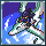

  

# 🌙 Mount & Journey FM

  **🐉 Montarias extraordinárias · ✨ Novas formas · 🌌 Uma jornada além do comum**

---

> **Fan-Made Mobile Port** · Terraria Mobile + Bunny Loader

**Sua próxima aventura começa quando você encontra uma nova forma de explorar o mundo.**

O **Mount & Journey FM** é um projeto fan-made e uma adaptação independente de *Mount & Journey* para **Terraria Mobile**, feita para funcionar com o **Bunny Loader**. A proposta é trazer ao mobile as montarias, transformações, acessórios e mecânicas especiais que tornam a jornada pelo mundo de Terraria ainda mais surpreendente.

> [!IMPORTANT]
> **Projeto comunitário, independente e não oficial.** Este port não é afiliado, endossado ou oficialmente conectado a Qz ou à Re-Logic. Os elementos do mod original continuam sujeitos aos direitos de seus respectivos titulares. A identificação como fan-made não representa uma autorização de redistribuição.

## ✨ Destaques do port

- **Montarias com estilos diferentes:** atravesse o céu, mergulhe, acelere pelo terreno e invista contra inimigos.
- **Transformações especiais:** experimente novas formas de movimentação e combate.
- **Acessórios que combinam:** misture bônus de velocidade, defesa, voo e investida.
- **O mistério da Orbe do Clima:** carregue energia e desencadeie ataques elétricos poderosos.
- **Várias formas de obtenção:** explore receitas, inimigos, pesca, baús e outros métodos implementados.
- **Adaptação para mobile:** scripts e comportamentos ajustados para o ambiente do Bunny Loader, com foco em compatibilidade e estabilidade.

> [!NOTE]
> O conteúdo ainda pode apresentar diferenças em relação à versão original de PC. A presença de um item ou arquivo não garante que todos os comportamentos tenham sido testados no jogo.

## 📖 Conteúdo do mod

### 🐉 Montarias

-  **Penas Antigas** (branca, azul e vermelha): invocam os Raptores. Correm mais rápido e viram com um quadro próprio.
-  **Salmão-Joia**: invoca o Otterron, que mergulha sem se cansar.
-  **Pena de Grifo**: invoca o Grifo, que voa por muito tempo e faz uma investida que fere inimigos.
-  **Trompa de Concha**: invoca o Cavalo-Marinho, que enche uma bolha na água (ou na chuva) e voa em hover.

-  **Óculos Arenosos**: invoca a Larva de Formiga-Leão, que voa em rajadas curtas.
-  **Prancha de Meteoro** (40 Meteorito, na bigorna): paira sobre o chão e a água e inclina com a velocidade.
-  **Cesta de Tentilhões** (madeira, sementes de Flor-do-dia, bancada): um bando de passarinhos te carrega.
-  **Joia da Montanha**: invoca o Dragão da Montanha, que voa por muito tempo e investe com toque duplo (ou o botão de investida).
-  **Flauta de Marfim**: invoca o Wyvern (corpo de 16 segmentos, +8 de defesa). Receita: Flauta Gasta, na bancada especial do original.
-  **Flauta Gasta**: pescada no espaço (pesca rara).
-  **Flauta Escamosa**: invoca o Arch Wyvern (+8% de dano).
-  **Flauta Lagarto**: invoca a Cobra Voadora, que morde inimigos por perto e envenena.
-  **Ovo de Aranha Gigante**: invoca a Aranha, de oito pernas que procuram o chão e as paredes (+8 de defesa).
-  **Sextante de Chamado** (26 Fragmentos Estelares, na Antiga Manipuladora): invoca o Starling, que voa sem limite e teleporta com toque duplo, com anões que soltam minas estelares.
-  **Semente Crescida** (6 sementes de erva, Bolota, no Tear Vivo): invoca a Semente, que voa presa ao chão por um caule.
-  **Bulbo Real**: invoca a Flor Crescida, com quatro ganchos de vinha que se prendem às paredes e ferem inimigos.
-  **Cinza Solar** (26 Fragmentos Solares, na Antiga Manipuladora): invoca a Fênix Solar, com investida em toque duplo e combo de até 7 investidas.
-  **Sigilo Cósmico** (26 Fragmentos de Nebulosa): invoca o Observador da Nebulosa, cujo olho segue o toque e empurra projéteis inimigos; +3 de regeneração de mana.
-  **Farol do Vórtice** (26 Fragmentos de Vórtice): invoca a Nave Vórtex, que atira as balas do inventário e foguetes.

### 🦊 Transformações

-  **Bolota Estranha** (7 Estrelas Cadentes, Bolota, na bancada): transforma você em Esquilo, que corre e pula mais.
-  **Bolinho de Arroz**: transforma você em Pardal, que voa por pouco tempo.
-  **Bola de Neve Macia**: transforma você em Raposa Ártica, que corre mais e mergulha em blocos de neve (segure para baixo; pule ou use um item para sair).
-  **Amuleto Ardente** (4 do item 1508, 80 do item 2701, 16 do item 173, bancada de Mithril/Oricalco): transforma você em Wyvern Alada, que voa por pouco tempo e cospe fogo na direção do toque. Segurando o ataque lança bolas de fogo que quicam e explodem; a ação alternativa solta um sopro de chamas.

### ⚡ Orbe do Clima

-  **Orbe do Clima Inerte** (3 Estilhaços da Orbe do Clima, 99 Estrelas Cadentes, 12 Barras de Luminita, na Antiga Manipuladora): arremesse durante uma tempestade e deixe flutuando por 5 segundos pra despertá-la, o que solta a Orbe do Clima. Se bater num bloco antes, devolve os 3 estilhaços.
-  **Orbe do Clima**: invoca o Dragão Mítico, de 24 segmentos, que voa sem limite e fica mais rápido quanto mais carregado. Ele se carrega voando e pela orbe: segure o ataque pra mandá-la até o cursor, onde ela explode em eletricidade nos inimigos que tocar, e solte pra ela voltar à testa do dragão e passar a carga. Com mais de 4 de carga, a ação alternativa (ou o botão de investida) descarrega tudo num raio que salta de inimigo em inimigo (100 de dano + 150 por ponto de carga).

### 🧿 Acessórios

Funcionam com qualquer montaria (o nome entre parênteses é o item usado na receita).

-  **Pipa de Trevo**: mais chance de crítico quanto mais rápido você vai.
-  **Amuleto do Companheiro**: +4 de defesa montado.
-  **Gema de Girassol**: +10% de velocidade e aceleração montado.
-  **Amuleto de Girassol** (Gema de Girassol, Amuleto do Companheiro): +14% de velocidade e aceleração, +8 de defesa.
-  **Balão de Nuvem**: mais pulo e +50% de voo.
-  **Balão Ensolarado** (Balão de Nuvem, Amuleto de Girassol): soma os dois.
-  **Chama do Dragão**: montado, toque duplo pro lado oposto inverte o impulso; a pé, a investida fica 12% mais forte.
-  **Pepita de Ouro Poderosa**: atropela inimigos em velocidade; +18% de resistência a mais de 8 de velocidade.
-  **Runa de Defesa Arcana**: +8 de defesa e fere quem encosta quando você está devagar.
-  **Sigilo do Poder** (Runa, Pepita, 6 Barras de Luminita): +16 de defesa e explode os inimigos que você atropela em velocidade.
-  **Flor Prisma**: depois de 1,5 s em movimento, +50% de velocidade.
-  **Estrela Cadente** (Flor Prisma, Chama do Dragão, 6 Barras de Luminita): impulso e +65% de velocidade; com o Sigilo do Poder, o atropelo vira um impacto estelar.

### 🎁 Drops e obtenção

- **Ovo de Aranha Gigante**: 1 em 22 de dois inimigos aranha. **Flauta Lagarto**: 1 em 85 dos Lihzahrd, depois de derrotar a Plantera. **Bulbo Real**: 1 em 10 da Plantera fora do Expert, ou 1 em 6 da bolsa dela.
- **Flor Prisma**: 1 em 10 da Imperatriz da Luz fora do Expert, ou 1 em 6 da bolsa dela.
- **Runa de Defesa Arcana**: 1 em 2 do Cultista Lunático. **Pepita de Ouro Poderosa** e **Pena de Grifo**: 1 em 7 cada, depois de um chefe mecânico. **Chama do Dragão** e **Joia da Montanha**: idem.
- **Flauta Gasta** (1 em 7) e **Flauta Escamosa** (1 em 14, depois de um chefe mecânico): da caixa do tipo 3985. **Óculos Arenosos**: 1 em 6 das caixas do deserto. **Bolinho de Arroz**: 1 em 6 num dia de vento, no hardmode.
- **Estilhaços da Orbe do Clima**: qualquer inimigo que não é chefe, 1 em 500 na neve ou na chuva e 1 em 1200 no resto.

### ✨ Efeitos visuais

- **Onda de calor** (Fênix Solar): durante a investida, anéis de calor se abrem em volta dela, o ar treme e uma onda de choque marca a saída.

### 🌎 Mundo e opções

- **Baús de madeira** de mundos novos têm 1 chance em 7 de guardar um **Amuleto do Companheiro** (só vale ao criar o mundo).
- Em **Configuração de Mods**, a opção *Glifos das montarias de pilar* liga ou desliga o brilho atrás do Vortex, do Starling e da Fênix Solar.

### 🔎 Como obter os itens

Tudo também sai pelo Mod Menu, na pasta *Itens* do mod. No jogo:

- **Penas Antigas** (branca, azul, vermelha): Extrator, ao processar Fóssil do Deserto no hardmode (1 em 100).
- **Bola de Neve Macia**: Extrator, ao processar Limo ou Neve com Lama (1 em 80).
- **Salmão-Joia**: pesca rara no Sagrado. **Trompa de Concha**: pesca rara na praia. **Flauta Gasta**: pesca rara no espaço.
- **Flauta Gasta**: também no Caixote (ID 3985, o mesmo do original) (1 em 7) e em baús celestes (1 em 3, só em mundos novos). **Flauta Escamosa**: Caixote (ID 3985, o mesmo do original) depois de um chefe mecânico (1 em 14).
- **Óculos Arenosos**: Caixote do Oásis ou da Miragem (1 em 6).
- **Ovo de Aranha Gigante**: aranhas de parede (1 em 22).
- **Flauta Lagarto**: lagartos do Templo depois da Plantera (1 em 85).
- **Bulbo Real**: Plantera (1 em 10 no Normal; 1 em 6 na bolsa).
- **Flor Prisma**: Imperatriz da Luz (1 em 10 no Normal; 1 em 6 na bolsa).
- **Pena de Grifo**, **Pepita de Ouro Poderosa**, **Joia da Montanha**, **Chama do Dragão**: depois de um chefe mecânico (1 em 7 cada).
- **Runa de Defesa Arcana**: 1 em 2 de um inimigo específico do jogo (NPC 439).
- **Amuleto do Companheiro**: baús de madeira (1 em 7, só em mundos novos).
- **Bolinho de Arroz**: no hardmode, num dia de vento, 1 em 6 de inimigos de IA 24 ao trocar de fase.
- **Estilhaços da Orbe do Clima**: qualquer inimigo (Sol 1 em 1200; Chuva e Neve 1 em 500, só de inimigos que soltam moedas).
- **Estilhaços da Orbe do Clima** também viram 100 de outro item na bancada de Garrafas: Neve (itens 3756 e 593), Tempestade (765 e 169), Sol (751 e 2).
- O resto (montarias, acessórios combinados, Orbe do Clima Inerte) sai de receita, listada acima.
